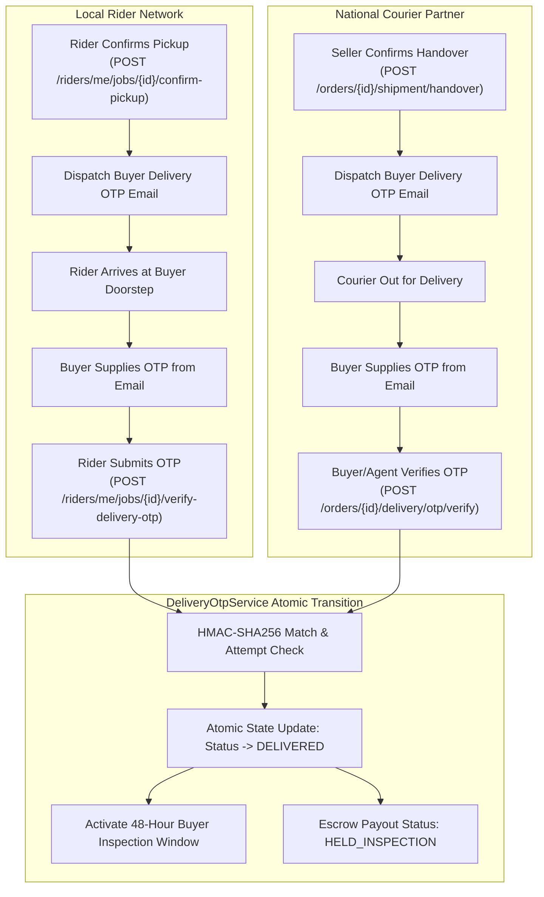

# REVALUE — DELIVERY GMAIL OTP INTEGRATION: PHASE B REPORT
**Backend Integration & Verification Audit**

- **Date:** November 20, 2026
- **Status:** COMPLETED & VERIFIED (Phase B ONLY)
- **Branch:** `feature/delivery-gmail-otp-phase-b-backend`
- **Base Commit:** `35083cc` (Phase A commit on `feature/delivery-gmail-otp-phase-a`)
- **Pytest Suite:** 98/98 PASSED (100% pass rate in 107.65s)

---

## 1. Executive Summary

Phase B successfully integrates ReValue's Google Apps Script Gmail gateway (`send_delivery_otp`) into the FastAPI backend service layer. This milestone activates automated, order-bound, cryptographically secured buyer doorstep delivery verification emails without modifying external SMTP credentials, introducing third-party email providers, or storing raw OTP codes in plaintext.

All 18 required Phase B test specifications passed without regression. The full test suite of 98 backend tests passed with zero failures.

---

## 2. Implementation Scope

The following files were created and updated to deliver Phase B:

| Component | Path | Description |
| :--- | :--- | :--- |
| **Configuration** | `backend/app/core/config.py` | Added constants for delivery OTP: `DELIVERY_OTP_EXPIRE_MINUTES = 10`, `DELIVERY_OTP_RESEND_COOLDOWN_SECONDS = 60`, `DELIVERY_OTP_MAX_ATTEMPTS = 5`, `DELIVERY_OTP_MAX_HOURLY_REQUESTS = 5`. |
| **Email Service** | `backend/app/services/email_service.py` | Extended `AppsScriptEmailProvider` and `EmailService` with `send_delivery_otp(...)`. Masked raw OTPs from error logs and response dictionaries. |
| **Central Service** | `backend/app/services/delivery_otp_service.py` | Built centralized `DeliveryOtpService` featuring domain-separated HMAC-SHA256 hashing, rate limiting, expiry validation, 5-attempt lockout, atomic compare-and-swap state completion, and legacy fallback support. |
| **Local Rider Flow** | `backend/app/services/rider_service.py` | Integrated `DeliveryOtpService` on pickup confirmation (`confirm_pickup`), added `resend_delivery_otp`, sanitized rider job dictionaries to strip OTP hashes/plaintext, and wired verification to activate the 48-Hour Inspection window. |
| **Courier Flow** | `backend/app/services/delivery_service.py` | Integrated `DeliveryOtpService` on courier physical handover (`confirm_handover`), added `resend_delivery_otp`, redacted buyer OTPs on public tracking in production mode, and enforced atomic delivery completion. |
| **API Endpoints** | `backend/app/api/v1/delivery.py` & `backend/app/api/v1/riders.py` | Exposed buyer/admin and rider resend endpoints (`POST /api/v1/orders/{order_id}/delivery/otp/resend`, `POST /api/v1/riders/me/jobs/{job_id}/resend-delivery-otp`). |
| **Automated Tests** | `backend/app/tests/test_delivery_gmail_otp.py` | Added 18 comprehensive automated test cases verifying security, rate limits, timeouts, redactions, lockout, concurrency, and legacy compatibility. |

---

## 3. Security Architecture

### 3.1 Domain-Separated Cryptographic Hashing
- **Zero Plaintext Storage:** Delivery OTPs are never persisted in plaintext in MongoDB Atlas in production.
- **HMAC-SHA256 Storage:** Codes are salted with a dedicated domain key derived from `SECRET_KEY + ":delivery_otp_domain"` and bound to the specific `order_id`:
  $$\text{hash} = \text{HMAC-SHA256}(K_{\text{domain}}, \text{order\_id} + ":" + \text{otp})$$
- **Constant-Time Verification:** Verification uses `hmac.compare_digest` to prevent timing side-channel attacks.

### 3.2 Authorization & Access Control
- Delivery OTP emails are dispatched **strictly** to the verified email address associated with the buyer user document (`db.users`).
- Address manipulation via shipping payload cannot redirect OTP dispatch to unverified third parties.
- Unverified buyers cannot receive OTPs or trigger completion.

### 3.3 Rate Limiting, Expiry & Lockout
- **Expiry:** Strict 10-minute window (`DELIVERY_OTP_EXPIRE_MINUTES = 10`).
- **Resend Cooldown:** 60-second minimum between resend requests (`DELIVERY_OTP_RESEND_COOLDOWN_SECONDS = 60`).
- **Hourly Ceiling:** Maximum 5 delivery OTP dispatches per hour per order (`DELIVERY_OTP_MAX_HOURLY_REQUESTS = 5`).
- **Failed Attempt Lockout:** Exactly 5 attempts allowed (`DELIVERY_OTP_MAX_ATTEMPTS = 5`). Upon 5th incorrect attempt, the record is flagged `is_locked = True`, rejecting subsequent attempts until re-issued.

### 3.4 Zero Sensitive Data Exposure
- **Public Tracking Redaction:** Plaintext OTP is omitted from `GET /api/v1/orders/{order_id}/tracking` in production and whenever Apps Script email gateway is active.
- **Rider Job Sanitization:** `_sanitize_job_doc` explicitly strips `delivery_otp` and `delivery_otp_hash` from all rider dispatch APIs and queries. Riders never see the buyer's delivery verification code.
- **Log Masking:** Logs only ever display masked representations (e.g., `••••12`).

### 3.5 Replay & Concurrency Prevention
- **Atomic Compare-and-Swap:** Order completion uses MongoDB `find_one_and_update` checking for unverified state and valid in-transit status.
- Once verified, `delivery_otp.verified = True` and attempts reset. Duplicate submissions return HTTP 409 Conflict.

---

## 4. Local vs Courier Delivery Flows

---

## 5. Configuration & Operational Controls

Existing production environment variables on Render remain untouched and fully supported:

- `APPS_SCRIPT_EMAIL_URL`: URL of the deployed Google Apps Script Web App.
- `APPS_SCRIPT_SHARED_SECRET`: Shared secret validated on every POST request.
- `ENVIRONMENT`: Set to `production` in live environments.

Development fallback mode:
- When running locally in test/dev with no Apps Script URL configured, `_dev_plain_otp` is attached for automated integration testing only.

---

## 6. Comprehensive Test Results

### 6.1 Phase B Test Suite (`test_delivery_gmail_otp.py`)
All 18 automated tests passed:

1. `test_verified_buyer_email_requirement` — PASSED
2. `test_successful_gmail_delivery_otp_dispatch` — PASSED
3. `test_invalid_buyer_email_rejection` — PASSED
4. `test_apps_script_gateway_failure` — PASSED
5. `test_invalid_otp_rejection_and_decrementing_attempts` — PASSED
6. `test_expired_otp_rejection` — PASSED
7. `test_five_incorrect_attempts_and_lockout` — PASSED
8. `test_resend_cooldown` — PASSED
9. `test_successful_one_time_verification` — PASSED
10. `test_wrong_order_association` — PASSED
11. `test_public_tracking_api_otp_redaction` — PASSED
12. `test_rider_dashboard_otp_redaction` — PASSED
13. `test_local_delivery_workflow_integration` — PASSED
14. `test_courier_delivery_handover_compatibility` — PASSED
15. `test_concurrent_verification_and_replay_prevention` — PASSED
16. `test_duplicate_delivery_completion_prevention` — PASSED
17. `test_legacy_order_compatibility` — PASSED
18. `test_existing_registration_otp_regression` — PASSED

### 6.2 Full Pytest Suite Execution
- **Command:** `pytest app/tests/ -v`
- **Result:** **98 passed in 107.65s (100% pass rate)**
- **Regressions:** 0 regressions detected.

---

## 7. Production Deployment Requirements

When Phase B is approved for deployment to Render:

1. **Prerequisites:**
   - Google Apps Script Phase A deployment is already live and tested.
   - `APPS_SCRIPT_EMAIL_URL` and `APPS_SCRIPT_SHARED_SECRET` are already present in Render environment variables.
2. **Merge & Deploy:**
   - Commit changes to `feature/delivery-gmail-otp-phase-b-backend`.
   - Push branch to GitHub.
   - PR / Merge into `main` after user review.
   - Render will build and deploy the updated FastAPI backend automatically.
3. **Post-Deployment Smoke Verification:**
   - Verify health endpoint: `GET /api/v1/auth/apps-script/ping`.
   - Perform test order dispatch in sandbox to confirm live Google Apps Script delivery email arrival.

---

## 8. Rollback Strategy

If any unforeseen issue occurs in production:
1. Revert to previous production commit on `main` (`f0207153` or Phase 2 commit `b468e895`).
2. Legacy orders with plaintext OTPs and existing registration flows remain fully functional due to backward compatibility safeguards.
3. Render automatic redeploy triggers within 2 minutes of git revert.
