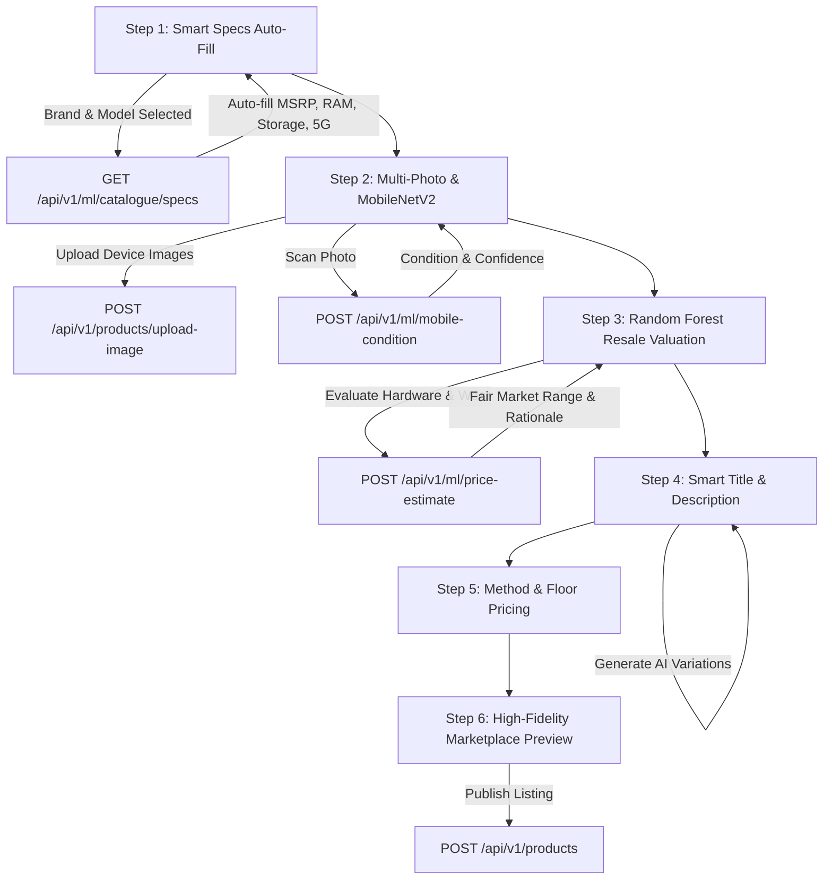

# REVALUE — PHASE 2 IMPLEMENTATION PLAN: AI-POWERED SMART PRODUCT LISTING

**Project:** ReValue — Secondary Smartphone Marketplace  
**Version:** Phase 2 Architecture & Implementation Plan  
**Target Branch:** `feature/phase2-ai-smart-listing` (branched from `main` @ `f020715`)  
**Status:** PROPOSED & READY FOR APPROVAL (READ-ONLY AUDIT STAGE)  
**Date:** November 2026  

---

## 1. Executive Summary & Objective

Phase 1 established a modern, responsive, and robust frontend design across ReValue with unified toast notifications, accessible confirm dialogs, skeleton loaders, and a polished dark slate/emerald theme.

**Phase 2 Objective:**  
Elevate the product listing workflow (`CreateListingPage.tsx`) into an **intelligent, AI-assisted smartphone listing experience** that makes listing a pre-owned smartphone faster, effortless, and substantially more accurate. 

Sellers will be guided through a streamlined 6-step wizard that integrates:
1. **Catalogue-Driven Auto-Fill:** Instant retrieval of canonical specs (MSRP, RAM, storage tiers, battery mAh, display size, 5G) via `/api/v1/ml/catalogue/specs`.
2. **Multi-Image Upload Dropzone:** Drag-and-drop batch photo uploads with client-side format/size validation, cover photo designation, and reordering.
3. **Inline MobileNetV2 Cosmetic Assessment:** Instant on-image condition scanning via `/api/v1/ml/mobile-condition`, providing confidence percentages and condition grade auto-selection.
4. **Random Forest Secondary Market Valuation:** Real-time algorithmic pricing via `/api/v1/ml/price-estimate`, presenting fair market value ranges and dynamic pricing rationale.
5. **AI-Assisted Title & Description Generation:** One-click generation of professional, structured listings tailored to device specs and condition.
6. **Market Value vs. Asking Price Distinction:** Visual market competitiveness indicators (Underpriced, Fair Market, Premium) with full seller sovereignty.
7. **High-Fidelity Marketplace Preview:** Realistic pre-publishing simulation of the buyer's view before committing to the database.
8. **Resilient UX:** Toast notifications, skeleton loaders, error retry states, and seamless recovery.

---

## 2. Preservation & Safety Guarantees

In accordance with ReValue safety rules:
1. **FastAPI Modular Backend:** 100% preserved. No route alterations, breaking API contract changes, or schema incompatibilities.
2. **Database Schemas & Data:** MongoDB Atlas `products`, `users`, `orders`, `auctions`, `offers` collections remain untouched. Existing records and fields are preserved.
3. **MobileNetV2 Model & Artifacts:** Preserved intact under `ml/mobile_condition/`. The 4-class classification pipeline (`predict_condition`) will be called directly through the existing `/api/v1/ml/mobile-condition` endpoint.
4. **Random Forest Model & Artifacts:** Preserved intact under `ml/price_prediction/`. The inference pipeline (`estimate_price`) and curated catalogue (`SmartphoneCatalogue`) will be consumed via existing `/api/v1/ml/price-estimate` and `/api/v1/ml/catalogue/...` endpoints.
5. **Authentication & Security:** JWT tokens, role-based authorization, and the Google Apps Script Gmail OTP gateway remain fully functional and uncompromised.
6. **Commerce Workflows:** Open negotiations, sealed-bid auctions, hybrid rider delivery, inspection checklists, and payout escrow flows remain fully intact.
7. **No Fabricated Capabilities:** ReValue will not claim object detection or automated hardware diagnostics unless powered by verified endpoints.

---

## 3. Existing System Audit & Baseline

| Component | Current Implementation | Phase 2 Enhancement |
| :--- | :--- | :--- |
| **Step 1: Specs** | Basic dropdown for brand and model; basic number inputs. | Brand selector chips for top brands + searchable select; instant catalogue spec cards (battery, screen size, 5G chip); smart RAM/storage selector buttons. |
| **Step 2: Photos** | Single-file upload at a time; separate modal for condition check (`AiConditionModal`). | Multi-file drag-and-drop zone; thumbnail gallery with cover photo selector; direct "Scan with MobileNetV2" action on any uploaded photo with inline confidence breakdown. |
| **Step 3: Valuation** | Simple price box with "Estimate Value" button. | Interactive valuation card showing Random Forest benchmark, low/high range, pricing explanation, and valuation sensitivity levers. |
| **Step 4: Details** | Basic auto-title (`Apple iPhone 13 (128GB) - Like New`); blank description textarea. | Multi-variant smart title generator; multi-template AI description generator (Professional, Quick-Sell, Comprehensive); accessories checklist. |
| **Step 5: Selling Method** | Negotiation vs. Bidding radio buttons with basic inputs. | Visual comparison cards; minimum offer floor calculator based on AI valuation; auction starting bid guidance. |
| **Step 6: Review** | Basic text summary box. | Full high-fidelity buyer-view preview card with image carousel, spec badges, seller trust indicators, and publish confirmation. |

---

## 4. Architectural Breakdown: The 6 AI-Powered Steps

### 4.1. Step 1: Smart Smartphone Brand & Model Selection with Specs Auto-Fill
- **Brand Selection:**
  - Quick-select pill row for top brands: *Apple, Samsung, Google, OnePlus, Xiaomi, Realme, Vivo, Motorola*.
  - Full searchable dropdown covering all 23+ supported brands from `SmartphoneCatalogue.get_supported_brands()`.
- **Model Auto-Complete & Catalogue Fetching:**
  - Selecting a brand immediately fetches `GET /api/v1/ml/catalogue/models?brand={brand}`.
  - Selecting a model triggers `GET /api/v1/ml/catalogue/specs?brand={brand}&model={model}`.
  - Automatically populates:
    - `original_retail_price` (Original MSRP in ₹).
    - `storage_options`: Rendered as interactive pill buttons (e.g. `[128 GB]`, `[256 GB]`, `[512 GB]`).
    - `ram_options`: Rendered as pill buttons (e.g. `[6 GB]`, `[8 GB]`).
    - Device badges: Display size (e.g., `6.1" OLED`), Battery capacity (`3279 mAh`), `5G Supported`.
- **Custom Model Fallback:**
  - One-click toggle "Enter Custom Model" if device is not in the curated catalogue.
  - All auto-filled inputs remain freely editable by the seller.

### 4.2. Step 2: Multi-Image Uploads & Inline MobileNetV2 Condition Assessment
- **Multi-File Upload Dropzone:**
  - Supports multi-file selection (`<input type="file" multiple ... />`) and drag-and-drop.
  - Immediate client-side validation: format (`image/jpeg`, `image/png`, `image/webp`), size (up to 5MB per file), max images (up to 8 images).
  - Parallel upload to `POST /api/v1/products/upload-image` with per-item progress indicators.
- **Image Management:**
  - Visual grid of uploaded photos with cover photo badge (`★ Primary Cover`).
  - Actions per photo: Set as Cover, Remove Photo, View Fullscreen.
  - Photo guidance tips: "1. Front screen illuminated", "2. Back casing & logo", "3. Side edges/corners".
- **Inline MobileNetV2 Condition Scanner:**
  - Every uploaded photo features an instant button: `Scan Photo with MobileNetV2`.
  - Sends image bytes to `POST /api/v1/ml/mobile-condition`.
  - Returns:
    - `predicted_condition`: `excellent`, `good`, `bad`, `defective`.
    - `confidence_score`: 0.0 to 1.0 (e.g. `94%`).
    - `class_probabilities`: breakdown across all 4 categories.
  - UI displays an animated confidence meter and offers one-click action: `Apply Condition Grade (e.g., Like New - 94% Confidence)`.
  - Condition grade radio cards automatically highlight the AI suggestion with an `AI Verified` badge.
  - Seller can override the grade at any time.

### 4.3. Step 3: Random Forest Resale Price Valuation & Competitiveness Analysis
- **Automatic Valuation Calculation:**
  - When transitioning from Step 2 to Step 3, the wizard automatically calls `POST /api/v1/ml/price-estimate`.
  - Payload incorporates: brand, model, condition, storage, RAM, battery health, age in months, original MSRP, screen crack, scratches, repair history, warranty.
- **Valuation Display:**
  - **Secondary Market Benchmark:** Prominent display of `estimated_price` in INR (e.g., `₹42,500`).
  - **Estimated Range:** Low to High range (e.g., `₹39,800 - ₹45,200`).
  - **Algorithmic Rationale:** Clear textual explanation from the model explaining factors (e.g., "88% battery health and original warranty increase value").
- **Clear Distinction: AI Benchmark vs. Asking Price:**
  - A dedicated comparison card explains:
    - *AI Valuation:* An algorithmic secondary market benchmark based on recent transaction data.
    - *Seller Asking Price:* The actual price the seller chooses to list at.
  - One-click button: `Apply AI Benchmark (₹42,500)` to set the asking price.
  - Ability to customize with dynamic feedback on market competitiveness:
    - **Under-Priced / Fast Sell** (Asking price < 90% of benchmark)
    - **Fair Market Value** (Asking price between 90% - 110% of benchmark)
    - **Premium Asking Price** (Asking price > 110% of benchmark)

### 4.4. Step 4: AI-Assisted Smart Title & Description Suggestions
- **Smart Title Generator:**
  - Provides 3 pre-computed title variants:
    1. *Concise / Standard:* `Apple iPhone 14 (128GB) - Like New`
    2. *Spec-Focused:* `Apple iPhone 14 128GB Blue • 88% Battery • Like New`
    3. *Complete Kit:* `Apple iPhone 14 (128GB) with Original Box & Charger • Flawless`
  - 1-click button to select any variant; fully editable text field.
- **Smart Description Generator:**
  - Generates structured, professional descriptions using templates that incorporate:
    - Device identity and physical condition grade.
    - Battery health and usage history.
    - Included accessories (Box, Original Charger).
    - Disclosed cosmetic wear (cracks, scratches, past repairs).
    - City location and delivery/pickup availability.
  - Seller can click `Generate AI Description` or compose their own.

### 4.5. Step 5: Selling Method Configuration & Price Floor Protection
- **Direct Buy & Open Negotiation:**
  - Asking price field linked with AI benchmark.
  - Private minimum acceptable price floor (`min_acceptable_price`): Offers below this are auto-rejected by the negotiation engine.
  - Helpful AI suggestion: "Recommended floor: 85% of asking price (₹36,100)".
- **Sealed-Bid Auction:**
  - Starting bid floor (`starting_bid`) with AI guidance: "Suggested starting bid: 75% of market value (₹31,800)".
  - Confidential reserve price (`reserve_price`): "Suggested reserve: 90% of market value (₹38,200)".
  - Auction duration selector (1, 3, 5, or 7 days).

### 4.6. Step 6: High-Fidelity Marketplace Preview & Submission
- **Buyer-View Simulation:**
  - Emulates the live product detail card seen on the marketplace:
    - Image carousel with thumbnail indicators.
    - Verified condition badge with AI confidence chip.
    - Price badge (Asking price or Starting bid).
    - Technical specs grid (Storage, RAM, Battery health, Color, Box, Charger).
    - Seller location chip and ReValue Trust guarantees (Escrow payment, In-person OTP inspection, 48-hr dispute window).
- **Edit Links:**
  - Quick "Edit" jump links back to specific steps (Specs, Condition, Price, Method) without losing state.
- **Publish Action:**
  - Calls `POST /api/v1/products` with complete validated payload.
  - On success: Displays celebration toast and navigates to the live product detail page.

---

## 5. UI/UX Details: States, Components & Accessibility

### 5.1. Feedback & Notifications
- Integrated with `ToastContext` (`useToast()`):
  - `showToast('success', 'Specs auto-filled from ReValue catalogue')`
  - `showToast('info', 'MobileNetV2 assessed condition as Like New (94% confidence)')`
  - `showToast('error', 'Image upload failed. Allowed formats: JPEG, PNG, WebP up to 5MB')`
  - `showToast('success', 'Listing published successfully!')`

### 5.2. Skeleton Loaders & Loading States
- When brand/model catalogue specs are loading: subtle pulsing skeleton chips for storage and RAM.
- When MobileNetV2 is scanning: animated radar pulse overlay on the photo preview with "Analyzing cosmetic wear...".
- When Random Forest pricing is computing: pulsing price card skeleton.
- During image upload: progress bar and spinner on the specific thumbnail.
- During listing submission: disabled buttons, spinner, and "Publishing your listing...".

### 5.3. Mobile & Responsive Layouts
- Horizontal scrollable step progress indicator on mobile screens (<640px).
- Sticky bottom action bar with `Back` and `Continue` / `Publish` buttons.
- Touch-friendly buttons and minimum 44px tap targets.

---

## 6. Implementation Task Breakdown

| # | Task | Files Affected | Estimated Scope |
| :--- | :--- | :--- | :--- |
| **2.1** | Create feature branch `feature/phase2-ai-smart-listing` | Git tree | 1 min |
| **2.2** | Build `MultiImageUploader` component with preview, progress, cover photo, and MobileNetV2 scan button | `frontend/src/components/MultiImageUploader.tsx` (new) | ~180 lines |
| **2.3** | Build `CatalogueSpecsCard` component with auto-fill chips, brand quick-select, and hardware summary | `frontend/src/components/CatalogueSpecsCard.tsx` (new) | ~150 lines |
| **2.4** | Build `AiPriceBenchmarkCard` component with comparison gauge, market competitiveness rating, and sensitivity levers | `frontend/src/components/AiPriceBenchmarkCard.tsx` (new) | ~160 lines |
| **2.5** | Build `SmartListingAssistant` helper for title variations and structured description generation | `frontend/src/utils/smartListingGenerator.ts` (new) | ~120 lines |
| **2.6** | Build `ListingPreviewCard` component simulating full buyer view before final submit | `frontend/src/components/ListingPreviewCard.tsx` (new) | ~170 lines |
| **2.7** | Overhaul `CreateListingPage.tsx` to orchestrate the enhanced 6 steps, integrate toast feedback, and wire modular components | `frontend/src/pages/CreateListingPage.tsx` | ~650 lines |
| **2.8** | Verify end-to-end frontend production build (`npm run build`) | `frontend/` | Verification |
| **2.9** | Run all backend pytest tests and frontend tests to ensure 100% regression safety | Backend & Frontend suites | Verification |
| **2.10** | Perform local browser testing and documentation | `docs/audit/` | Verification |

---

## 7. Testing & Verification Matrix

| Test Category | Target Check | Expected Result |
| :--- | :--- | :--- |
| **Brand & Model Selection** | Select brand "Samsung" | Fetches models (Galaxy S23, S22, etc.). |
| **Catalogue Specs Auto-fill** | Select "Apple iPhone 14" | Populates MSRP (₹79,900), Storage chips (128, 256, 512), RAM (6GB), 5G badge. |
| **Multi-Image Upload** | Drag 3 valid images (JPEG, 2MB each) | All 3 upload concurrently, preview thumbnails display, first photo is cover. |
| **MobileNetV2 Scanning** | Click "Scan with MobileNetV2" on photo | Calls `/api/v1/ml/mobile-condition`, returns condition + confidence %, applies grade on click. |
| **Random Forest Pricing** | Transition to Step 3 | Calls `/api/v1/ml/price-estimate`, returns accurate price + range, shows competitiveness indicator. |
| **AI Suggestions** | Click "Generate Descriptions" | Offers 3 title options and structured text with all phone specs; seller can edit. |
| **Seller Sovereignty** | Change asking price from ₹42,000 to ₹46,000 | Allowed without blocking; updates competitiveness badge to "Premium". |
| **Final Review** | Step 6 Preview | Accurately mirrors buyer view with image carousel and full specs. |
| **Submission** | Click "Publish Listing" | Creates product in MongoDB via API, shows success toast, navigates to product page. |
| **Build & Test Safety** | `npm run build` and `pytest` | 0 build errors, 0 test failures, 100% backward compatibility. |

---

## 8. Summary & Next Actions

This implementation plan preserves all existing ReValue functionality while transforming the smartphone selling experience into an industry-grade, AI-assisted workflow.

**Awaiting user approval before proceeding to implementation.**
