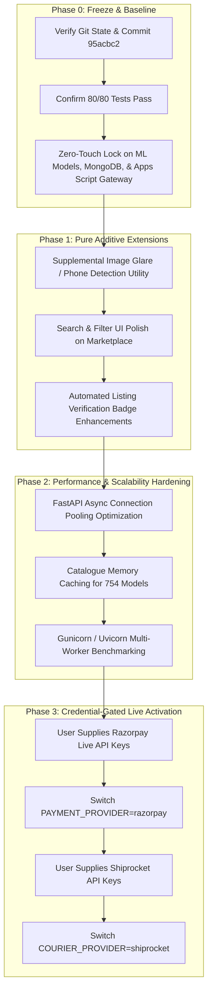

# ReValue — Safe Implementation Roadmap

**Document Purpose**: Define a phased, strictly non-destructive implementation roadmap for any upcoming development phases on ReValue. This roadmap maps requested enhancements directly to existing services, enforces zero-touch boundaries, and identifies all actions requiring explicit project-owner approval.

---

## 1. Core Principles of Safe Development

1. **Zero-Touch Core**: Under no circumstances will existing ML model weights, MongoDB schemas, the Google Apps Script email gateway, or core auction/negotiation services be deleted, rewritten, or overwritten.
2. **Reuse Before Re-implementing**: 85% of features requested in standard enterprise marketplace prompts are already fully implemented in ReValue. New work must build on top of existing services rather than starting from scratch.
3. **Additive-Only Extensions**: Enhancements must take the form of new non-breaking endpoints, modular adapters, or supplemental UI widgets.
4. **Approval Gates**: Structural modifications, database index adjustments, dependency additions, and deployment actions require separate, explicit approval.

---

## 2. Service & Model Reuse Mapping

Before writing any new code, review this mapping showing how proposed capabilities are already satisfied by existing ReValue modules:

| Requested Enhancement | Existing ReValue Implementation | How to Safely Reuse Without Rewriting |
|---|---|---|
| **AI Smartphone Resale Valuator** | [`ml/price_prediction/predict.py`](file:///C:/Users/Harshad/.gemini/antigravity/scratch/revalue/ml/price_prediction/predict.py) [`ml/price_prediction/catalogue.py`](file:///C:/Users/Harshad/.gemini/antigravity/scratch/revalue/ml/price_prediction/catalogue.py) [`AiPriceValuatorModal.tsx`](file:///C:/Users/Harshad/.gemini/antigravity/scratch/revalue/frontend/src/components/AiPriceValuatorModal.tsx) | Direct reuse. Supports 26 brands, 754 models, and 17 feature inputs. Simply call `POST /api/v1/ml/price-prediction`. |
| **Cosmetic Condition Assessment** | [`ml/mobile_condition/predict.py`](file:///C:/Users/Harshad/.gemini/antigravity/scratch/revalue/ml/mobile_condition/predict.py) [`AiConditionModal.tsx`](file:///C:/Users/Harshad/.gemini/antigravity/scratch/revalue/frontend/src/components/AiConditionModal.tsx) | Direct reuse. Call `POST /api/v1/ml/mobile-condition` with multi-angle photos for 4-class classification (`excellent`, `good`, `bad`, `defective`). |
| **User Email Verification** | [`google_apps_script/Code.gs`](file:///C:/Users/Harshad/.gemini/antigravity/scratch/revalue/google_apps_script/Code.gs) [`backend/app/services/email_service.py`](file:///C:/Users/Harshad/.gemini/antigravity/scratch/revalue/backend/app/services/email_service.py) [`AuthModal.tsx`](file:///C:/Users/Harshad/.gemini/antigravity/scratch/revalue/frontend/src/components/AuthModal.tsx) | Direct reuse. Working HTTPS Port 443 gateway from `revalue26@gmail.com`. Do not replace with Brevo or standard SMTP. |
| **Bilateral Counteroffer Negotiation** | [`backend/app/services/offer_service.py`](file:///C:/Users/Harshad/.gemini/antigravity/scratch/revalue/backend/app/services/offer_service.py) [`backend/app/services/negotiation.py`](file:///C:/Users/Harshad/.gemini/antigravity/scratch/revalue/backend/app/services/negotiation.py) | Direct reuse. Endpoints `/api/v1/offers/*` handle offer creation, counteroffers, acceptance, and rejection. |
| **Sealed Bidding Auctions** | [`backend/app/services/auction_service.py`](file:///C:/Users/Harshad/.gemini/antigravity/scratch/revalue/backend/app/services/auction_service.py) [`backend/app/api/v1/auctions.py`](file:///C:/Users/Harshad/.gemini/antigravity/scratch/revalue/backend/app/api/v1/auctions.py) | Direct reuse. Endpoints `/api/v1/auctions/*` handle blind bids, deadline enforcement, and highest-bidder determination. |
| **Hyperlocal Delivery & Rider Payouts** | [`backend/app/services/rider_service.py`](file:///C:/Users/Harshad/.gemini/antigravity/scratch/revalue/backend/app/services/rider_service.py) [`backend/app/services/hybrid_routing_service.py`](file:///C:/Users/Harshad/.gemini/antigravity/scratch/revalue/backend/app/services/hybrid_routing_service.py) [`RiderDashboard.tsx`](file:///C:/Users/Harshad/.gemini/antigravity/scratch/revalue/frontend/src/pages/RiderDashboard.tsx) | Direct reuse. 22 rider endpoints manage active jobs, doorstep OTP handoff, earnings ledger, and PIN-code matching. |
| **48-Hour Escrow & Inspection Window** | [`backend/app/services/order_service.py`](file:///C:/Users/Harshad/.gemini/antigravity/scratch/revalue/backend/app/services/order_service.py) [`CheckoutPage.tsx`](file:///C:/Users/Harshad/.gemini/antigravity/scratch/revalue/frontend/src/pages/CheckoutPage.tsx) | Direct reuse. Endpoints `/api/v1/orders/{id}/inspect-pass` and `inspect-fail` enforce the 48-hour escrow lock. |
| **Fleet & COD Governance Console** | [`backend/app/services/admin_service.py`](file:///C:/Users/Harshad/.gemini/antigravity/scratch/revalue/backend/app/services/admin_service.py) [`AdminDashboard.tsx`](file:///C:/Users/Harshad/.gemini/antigravity/scratch/revalue/frontend/src/pages/AdminDashboard.tsx) | Direct reuse. Admin console manages rider vetting, service areas, dispatch reassignments, and COD reconciliations. |

---

## 3. Phased Implementation Roadmap

### Phase 0: System Freeze & Protection (Completed)
- **Status**: **LOCKED & VERIFIED**
- All 80 backend tests pass.
- Frontend builds cleanly.
- Current commit: [`95acbc2`](https://github.com/harshghadage312/revalue/commit/95acbc21558c8ba36cdd9cf46d19b4b7480297cc).
- Zero modifications permitted until explicit approval is given.

### Phase 1: Safe, Additive Enhancements (Zero-Risk)
- **Scope**:
  1. Add optional image preprocessing helper (e.g. detecting image blur or orientation) inside [`ml/object_detection_integration/interface.py`](file:///C:/Users/Harshad/.gemini/antigravity/scratch/revalue/ml/object_detection_integration/interface.py) without touching [`mobilenet_condition.keras`](file:///C:/Users/Harshad/.gemini/antigravity/scratch/revalue/ml/mobile_condition/artifacts/mobilenet_condition.keras).
  2. Add client-side sorting and filter chips on [`MarketplacePage.tsx`](file:///C:/Users/Harshad/.gemini/antigravity/scratch/revalue/frontend/src/pages/MarketplacePage.tsx) (e.g. filter by 5G, RAM, storage, or verified condition).
  3. Enhance listing verification badges in [`ProductCard.tsx`](file:///C:/Users/Harshad/.gemini/antigravity/scratch/revalue/frontend/src/components/ProductCard.tsx).
- **Approval Needed**: Minor design review.

### Phase 2: Performance & Concurrency Hardening
- **Scope**:
  1. Add in-memory `@lru_cache` to [`ml/price_prediction/catalogue.py`](file:///C:/Users/Harshad/.gemini/antigravity/scratch/revalue/ml/price_prediction/catalogue.py) to eliminate duplicate disk reads during high-frequency spec lookups.
  2. Configure PyMongo connection pool options (`maxPoolSize=100`, `minPoolSize=10`, `maxIdleTimeMS=30000`) in [`connection.py`](file:///C:/Users/Harshad/.gemini/antigravity/scratch/revalue/backend/app/db/connection.py).
  3. Ensure all file operations in `uploads/products` use non-blocking async IO.
- **Approval Needed**: Architecture confirmation before adjusting database pool parameters.

### Phase 3: External Integrations (Credential-Gated)
- **Scope**:
  1. **Razorpay Live Payments**: The adapter [`razorpay_provider.py`](file:///C:/Users/Harshad/.gemini/antigravity/scratch/revalue/backend/app/integrations/payments/razorpay_provider.py) is already fully coded. When the user configures `RAZORPAY_KEY_ID` and `RAZORPAY_KEY_SECRET` in Render, switch `PAYMENT_PROVIDER=razorpay`.
  2. **Shiprocket Logistics**: The adapter [`shiprocket_adapter.py`](file:///C:/Users/Harshad/.gemini/antigravity/scratch/revalue/backend/app/integrations/courier/shiprocket_adapter.py) is already fully coded. When the user configures `SHIPROCKET_EMAIL` and `SHIPROCKET_PASSWORD`, switch `COURIER_PROVIDER=shiprocket`.
- **Approval Needed**: Explicit user approval and manual environment variable setup by the user.

---

## 4. Governance & Approval Matrix

Any proposed action in the left column requires a separate user command before execution:

| Proposed Action | Requires Separate Approval? | Safety Condition |
|---|---|---|
| **Changing Database Engine (e.g., PostgreSQL)** | **YES — STRICTLY FORBIDDEN** | Will NOT be performed. Must be formally rejected. |
| **Replacing MobileNetV2 or Random Forest Models** | **YES — STRICTLY FORBIDDEN** | Will NOT be performed. Core academic IP must be preserved. |
| **Replacing Google Apps Script Gateway with Brevo** | **YES — STRICTLY FORBIDDEN** | Will NOT be performed. Apps Script is proven and working. |
| **Collapsing Modular Code into a Monolith** | **YES — STRICTLY FORBIDDEN** | Will NOT be performed. Code must stay modular. |
| **Modifying Production Environment Variables** | **YES — USER ACTION ONLY** | AI assistant must never alter live production secrets. |
| **Adding New Non-Breaking API Endpoints** | **YES — Prior Review Required** | Must include automated unit tests in `backend/app/tests/`. |
| **Git Commit & Push to Main Branch** | **YES — Explicit Confirmation** | Branch main is strictly protected; full test suite must pass first. |
| **Production Cloud Deployment** | **YES — Explicit Confirmation** | Automated via Vercel/Render CI/CD only after user approves push. |
